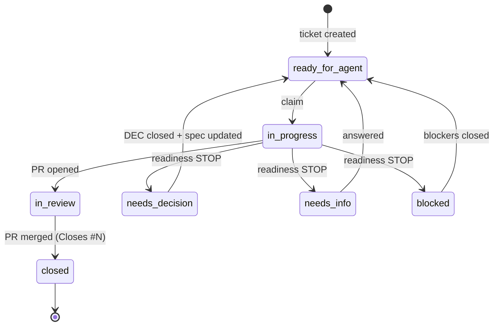

# Issue tracker: GitHub

Tickets are GitHub issues in this repository. Use the `gh` CLI. Bodies of build tickets follow the shape in `docs/backlog/tickets/*.md` (the source of truth; issues are created from them by `tools/backlog/backlog.py create`).

## Commands agents use
```
gh issue view <N> --comments                       # read a ticket and its thread
gh issue list --label ready-for-agent --state open # candidate list (prefer: python tools/backlog/backlog.py next)
gh issue edit <N> --add-label status:in-progress --add-assignee @me
gh issue comment <N> --body-file .scratch/comment.md
gh issue create --title "..." --body-file .scratch/issue.md --label needs-triage
gh pr create --title "[T-NN] ..." --body-file .scratch/pr-body.md
gh issue close <N> --comment "..."                 # normally closed by the PR keyword instead
```
Creating labels (once, by the maintainer): `bash tools/backlog/create-labels.sh`.

## Hierarchy and dependencies
- **Parent:** every ticket is a sub-issue of the spec issue (type:spec). Created natively when the installed `gh` supports `gh issue create --parent` (the AI Hero `/to-tickets` page cites gh 2.94 or newer; verify with `gh issue create --help`).
- **Blocking:** natively via `--blocked-by` when supported. **Regardless of native support, every issue body ends with machine-readable footers**:
  `<!-- local-id: T-05 -->`, `<!-- blocked-by: #12,#15 -->`, `<!-- blocks: #20 -->`.
  Tooling (`next`, `on-merged`) reads the footers, so the graph works on any plan or gh version.
- Never edit footers by hand; regenerate with `backlog.py create` or fix the ticket file and re-sync.

## Claiming
Assignee plus `status:in-progress` is the claim. It is not a lock: always check both before starting, and release (unassign, remove label) when you STOP.

## Label state machine

Labels: `ready-for-agent` stays on the ticket for its whole life; `status:*` labels carry the live state. The frontier excludes any ticket with a `status:*` label or `needs-info`.

## The `ready-for-agent` pitfall
Never put `ready-for-agent` on the spec, a wayfinder map, a decision ticket or a retro: an unattended agent polling for that label would try to "implement" it. `backlog.py validate` fails if this happens.

## Triage of human-filed issues
Raw issues get `needs-triage`; use `/triage` to sort them (questions to `needs-info`, ready work to `ready-for-agent` or `ready-for-human`, rejects to `wontfix`). Tickets created by `/to-tickets` or `backlog.py create` are already agent-ready and must not be re-triaged.
