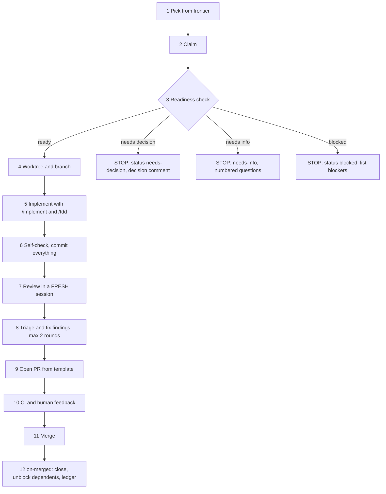

# Ticket runner: the protocol for one ticket

One ticket, one fresh session, one worktree, one PR. Follow every step in order. If a step says STOP, stop: post what is asked, leave the issue in the stated state, and end the session. Do not improvise around a STOP.




## 0. Preconditions
Fresh session. `git status` clean on `main`, up to date with `origin/main`. Skills installed (`/implement`, `/tdd`, `/code-review`, `/pr`, `/domain-modeling`, `/grilling`, `/handoff`). `gh auth status` ok. You have read `AGENTS.md`, `GLOSSARY.md`, `CODING_STANDARDS.md`.

## 1. Pick
```
python tools/backlog/backlog.py next          # the frontier, ordered by phase then number
```
Take the first entry unless the human named a ticket. The frontier already excludes spec, map, decision and retro issues, issues with open blockers, and issues labelled `status:*` or `needs-info`. If it is empty: report "nothing pickable", list what is blocking the lowest-numbered ready ticket, stop.

## 2. Claim
```
gh issue edit <N> --add-assignee @me --add-label status:in-progress
gh issue comment <N> --body "Claimed. Branch: t-<NN>-<slug>. Session started <UTC time>."
```
If the issue already has an assignee or `status:in-progress`, pick the next entry; never take over silently.

## 3. Readiness check (Definition of Ready)
Read, in this order: the ticket body (every section), its linked blockers' merged PRs, `docs/spec/SPEC.md` sections the ticket cites, `GLOSSARY.md`, relevant ADRs in `docs/adr/`. Then answer each item **yes/no with evidence**:

| # | Check | Fail means |
|---|---|---|
| R1 | I can state the behaviour to build in two sentences without guessing | needs-info |
| R2 | The demo path is concrete and runnable | needs-info |
| R3 | Every acceptance criterion is observable and would fail on current `main` | needs-info |
| R4 | The seams for my tests are named, and I know where each test lives | needs-decision |
| R5 | Every blocker issue is **closed and merged to `main`** (verify with `gh`, do not trust labels) | blocked |
| R6 | Every DEC/SPK this ticket lists is closed, and its resolution is reflected in SPEC-01 | blocked or needs-decision |
| R7 | No contract, state-machine row, schema field, policy cell, file format, dependency or security choice is left to me | needs-decision |
| R8 | The ticket fits one context window (size S/M) and has no hidden second feature | needs-decision (split) |
| R9 | The toolchain commands to run exist (lint, types, tests) | blocked (T-01 not done) |
| R10 | Security and failure notes cover the risky parts, or I can name none | needs-info |

Post the report as an issue comment using the template in `decisions-and-questions.md` ("Readiness report"). Then:
- **All yes -> READY.** Continue.
- **Any `needs-decision` -> STOP.** Remove `status:in-progress`, unassign yourself, add `status:needs-decision`, create or link a decision ticket (template `decision.md`), post the **decision comment**. Do not guess, do not implement a "reasonable default".
- **Any `needs-info` -> STOP.** Remove `status:in-progress`, unassign, add `needs-info`, post numbered questions (**question comment**).
- **Any `blocked` -> STOP.** Remove `status:in-progress`, unassign, add `status:blocked`, list the open blockers by number.

**Decision vs assumption.** An *assumption* is a detail the ticket and spec leave open that cannot change a contract, behaviour visible to a user of the CLI, an on-disk format, a test expectation or a security property (for example a private helper's name). Assumptions are allowed and are listed in the PR under "Assumptions". Anything else is a *decision* and requires a STOP.

## 4. Worktree and branch
```
git fetch origin
git worktree add ../agents-factory-t<NN> -b t-<NN>-<slug> origin/main
cd ../agents-factory-t<NN>
```
Branch `t-<NN>-<slug>`: ticket id lower-cased, kebab slug of the title. Never work in the main checkout when other sessions are active (`parallel-work.md`).

## 5. Implement
Run `/implement #<N>`. It builds with `/tdd`. Rules for this repo on top of the skills:
1. Work the ticket's **TDD plan** in order: one failing test, minimum code, repeat. Confirm each test fails for the right reason first.
2. Tests only at the seams the ticket names. No mocks of our modules (CS-21). Literals, not recomputed values (CS-22).
3. Commit small and often: `<type>: <summary>` with a body line `Refs #<N>`. Types: `feat`, `fix`, `test`, `docs`, `chore`, `refactor`.
4. Update `GLOSSARY.md` when you introduce or settle a noun. Use `/domain-modeling` if a term is contested. Write an ADR only if it clears the three-part bar (`domain.md`).
5. Discoveries outside the ticket's scope: `gh issue create --label needs-triage` with a link back; do not fix them here.
6. Do not edit other tickets' bodies unless this ticket says so.

## 6. Self-check and commit
Run lint, type-check and the full default test suite; run every command listed in the ticket's Demo path and acceptance criteria and note the evidence (output excerpts, before/after). Check each acceptance criterion honestly; an unchecked criterion means you are not done. **Commit everything**, including docs. The last commit message ends with a line `Closes #<N>`. Uncommitted work is invisible to the reviewer.

## 7. Review (senior AI engineer, fresh session)
Start a **new session** (the writer must not review its own work). Follow `review-protocol.md`: run `/code-review` against `git diff $(git merge-base origin/main HEAD)...HEAD`, then the senior supplement and the security checklist. Output: a findings table in `.scratch/review-t<NN>.md` (gitignored). Do not edit code in the review session.

## 8. Fix findings
Back in the implementation session: triage each finding (`review-protocol.md` section "Triage"). Fix every `blocker` and `major`; fix `minor` when cheap; skip `nit`. One commit per finding: `fix(review): F-<n> <summary>`. Re-run all checks. Ask the reviewer session for a **targeted re-review of only the changed hunks** (round 2). At most **two rounds**; anything left is listed in the PR under "Findings not addressed" with a reason, or escalated as a decision.

## 9. Open the PR
Run `/pr`, but fill `.github/pull_request_template.md` (the repo template wins; `/pr`'s Summary, Evidence and Merge Danger sections live inside it). Rules and field meanings are in `pr-protocol.md`. Push and open:
```
git push -u origin t-<NN>-<slug>
gh pr create --title "[T-<NN>] <ticket title>" --body-file .scratch/pr-body.md
gh issue edit <N> --remove-label status:in-progress --add-label status:in-review
gh issue comment <N> --body "PR opened: <url>. Review rounds: <k>. Findings fixed: <n>."
```
Before pushing, run `python tools/backlog/backlog.py check-pr --body-file .scratch/pr-body.md`; it must print `PR body OK`.

## 10. CI and feedback
Wait for CI. Fix failures with new commits. Treat human review comments with the same triage as findings; reply to each. If scope changes, **rewrite the PR body** (never leave it stale). If a human asks for something outside the ticket, open a new issue instead.

## 11. Merge
Squash or rebase per the repo setting, keeping `Closes #<N>` in the final message. Humans merge unless the maintainer has enabled auto-merge for green PRs on `mvp`-labelled tickets.

## 12. After merge (automatic, with a manual fallback)
The `on-pr-merged` workflow runs `python tools/backlog/backlog.py on-merged --pr <number>`, which: removes `status:*` labels from the closed ticket, comments on it with the PR and merge commit, comments "Unblocked" on each dependent whose blockers are now all closed, and adds a ledger line on the spec issue. If the workflow did not run, run the same command by hand. Then check the closed issue's acceptance checkboxes match what the PR evidence shows (edit the issue body to tick them), and end the session.

## Handoff
If you must stop mid-ticket: run `/handoff`, commit what compiles and passes, push the branch, and leave an issue comment with branch name, what is done, what is next, and any open question. Keep `status:in-progress`.

## Special ticket types
- **Decision (DEC-xx):** human-in-the-loop. Run a `/grilling` interview, record the resolution in the template, update SPEC-01 and the map's "Decisions so far", add an ADR if it clears the bar, open a docs PR `Closes #<DEC>`. See `decisions-and-questions.md`.
- **Spike (SPK-xx):** produce the evidence document named in the ticket; no product code; PR `Closes #<SPK>`.
- **Retro (RET-xx):** run `/retro`; PR changes guidance only.
- **Chore (T-01, ...):** no TDD plan; verify with the commands in the acceptance criteria.
