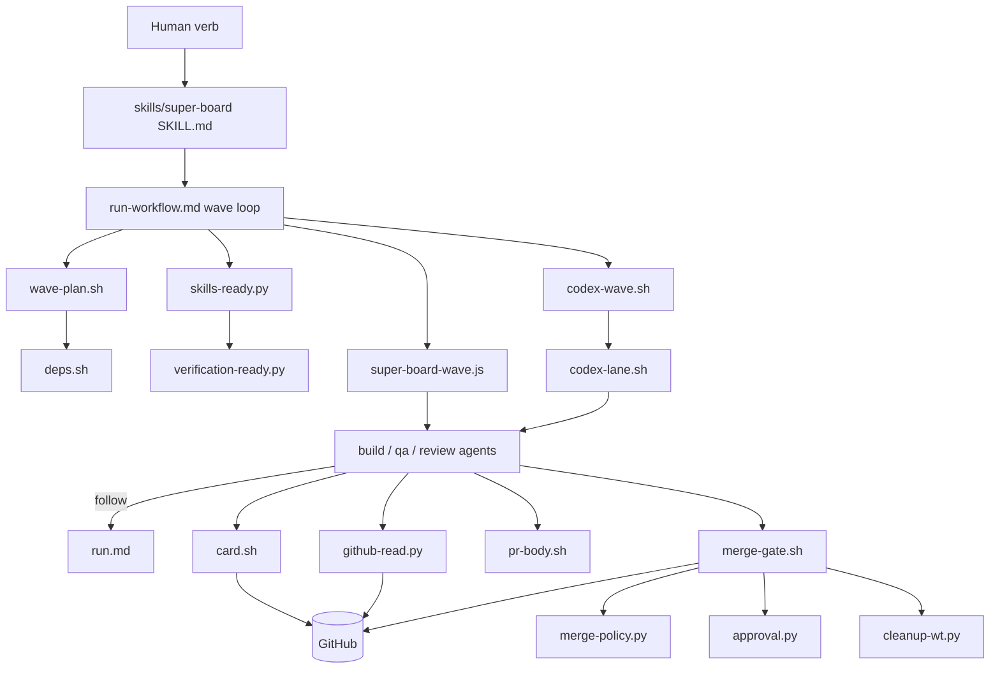

# 03 — Architecture and Dependencies

## 1. Actual layers (vs the conceptual model in the brief)
| Conceptual layer | Present? | Actual realization | Level |
|---|---|---|---|
| Entry / UI | Yes | Slash-skill verbs; `status.py` renders an 80-col board | V |
| Request intake | Partial | Humans write issues (`ticket-format.md`); `super-collect` auto-files | V |
| Repo discovery | Yes | `super-board-setup.py`, onboard Silent Detect, `PROJECT.md`, AGENTS.md merge | V/D |
| Spec / requirements | Weak | ACs in the issue; `lint`; no spec artifact generated by the factory | V |
| Planning | Yes (mechanical) | `wave-plan.sh` + deps graph; no semantic plan/DAG creation | V |
| Orchestration | Yes | LLM orchestrator (prose) + `super-board-wave.js` | V |
| Scheduling | Yes | Host concurrency cap (min(16,cpus−2) per `wave-plan.sh` comments); Codex wave uses `max_workers` | V/D |
| Agent execution | Yes | `agent()` / `codex exec` / `claude -p` | V |
| Skills & knowledge | Yes | 8 skills + references + external skills | V |
| Harness adapters | Partial | Codex scripts only; Claude = native | V |
| Shared state | Yes | GitHub + `.claude/super-board/*` + run manifests | V |
| Approval / policy | Yes | `merge-policy.py`, `approval.py`, Block templates | V |
| Verification | Partial | Executable only in merge gate; elsewhere delegated to agents | V |
| Code review | Yes | Reviewer lane (LLM) | D |
| Integration / delivery | Yes | merge gate → squash merge, migrations | V |
| Logging / observability | Weak | PR comments, run manifest, `status.py`; no structured event log found | V (negative, limited to state-path inventory) |
| Packaging | Yes | plugin + `install.sh`/`get.sh`, release workflow | V |

## 2. Dependency graph
See `diagrams/current-architecture.mmd` (rendered below in simplified form).

**Coupling findings**
- **Tight, implicit:** lane agents locate behavior by *path strings in prompts* (`.claude/skills/super-board/references/run.md`, `.claude/bin/...`). A moved file breaks at agent runtime, not at load (V, wave.js L146-174).
- **Global authorities:** board column (card status), assignee (claim), config JSON (no schema loader), REGISTRY dict (skills), `writing-standard.md` (formats).
- **Duplication:** lane lifecycle in run.md + wave.js prompts + codex-lane prompt + run.sh; ladders in 2 files; tokenizer in 3 hooks; `READ_SHAPES` in wave.js mirrors `validate()` in github-read.py (kept in sync by a comment and test `tests/test_github_reads.py`).
- **Circular dependencies:** none found among scripts; a *conceptual* cycle exists: merge-gate calls cleanup-wt, which is also invoked by SessionStart (acceptable, idempotent).
- **Declared vs assumed:** tools declared and checked by setup; skills declared in REGISTRY; directory layout, hook availability, Workflow runtime, status-line `rate_limits` recording are assumed.

## 3. Boundaries and contracts
| Subsystem | Entry | Input | Output | Error / retry | Extension point | Explicit? |
|---|---|---|---|---|---|---|
| Wave planner | `wave-plan.sh --config [--items --deps]` | config + board JSON | JSON `{cards,sweep,resume,refreshApproval,flag,stranded}` | exit 64/65/66, 9, 79 | `max_workers`, labels | Explicit (header doc) |
| GitHub reader | `github-read.py --kind K -- <gh args>` | gh args | validated JSON/text | 3 attempts; exit 64 (shape), 79 (halt); `--check/--resume/--halt` | new `--kind` in `validate()` | Explicit |
| Wave workflow | `args {configPath,cards,tier}` | JSON (string tolerated) | `{cards:[{number,finalStatus,lastLane,column,detail,prUrl,priorFindings,lanesRun}],halted}` | halted flag; null result ⇒ failed | `LANES`, `LADDERS` constants | Explicit schema in JS (not in a schema file) |
| Lane result | `STAGE_SCHEMA` | agent output | `{status∈advanced,bounced,blocked,human-gate,failed,halted; column; detail; prUrl; branch; priorFindings}` | schema-validated by host (U how strict) | enum edit | Explicit; duplicated in codex-lane.sh |
| Merge gate | `merge-gate.sh --config --pr --expect-head …` | PR + config | exit 0,2–9,79 + stdout lines `human-gate:`, `needs-you:`, `approval-request:` | see 04 | `merge_policy`, `migrations` config | Explicit exit table |
| Approval | `approval.py --repo --pr --head --plan [--request]` | comments + plan | `{approved,why,request,approver…}` | hold on ambiguity | — | Explicit |
| Skills resolver | `skills-ready.py --cards - --host --lane [--require] [--catalog --home]` | cards JSON | readiness report; exit 10/64 | — | REGISTRY edit, issue `Skills:` line | Explicit |
| Comments/PR body | marker blocks, `<!-- super-review:report -->`, `approval-request: {json}` | text | parseable markers | `pr-body.sh` rewrites one block idempotently | `writing-standard.md` | Explicit + tested |
| Config | `.claude/super-board/configs/<slug>.json` | many keys | — | none central | — | **Implicit** (reference doc only) |
| Hooks | JSON stdin → JSON `permissionDecision` | tool call | allow/deny | fail-open | settings snippet | Explicit (Claude contract) |

## 4. Verdict
Boundaries between *scripts* are crisp and tested; boundaries between *prose and code* (lanes ↔ scripts, config ↔ everything) are implicit. The architecture is a thin deterministic shell around LLM lanes, with the shell's quality highest at the merge/read/approval edges and lowest in loop control and configuration.
