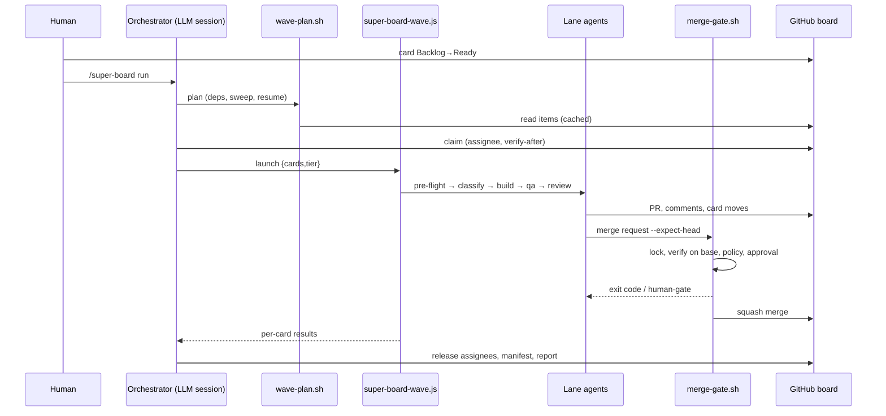

# 04 — End-to-End Workflow (default `worker_backend:"workflow"`)

Detailed call chains with line anchors are in `evidence/workflow-evidence.md`. Diagram: `diagrams/current-workflow.mmd`. Each stage is rated on the three-level scale from the brief: **[Doc]** the documentation says it should happen · **[Mech]** the implementation contains a mechanism that could make it happen · **[Run]** verified in execution. **No stage is [Run]** — nothing was executed.

## 6.1 Initial entry
| Item | Finding | Level |
|---|---|---|
| Start | User types `/super-board run` (or `onboard` first). Host loads `skills/super-board/SKILL.md`, which routes the verb to one reference file | V |
| Parsing | Flags `--low`/`--high` (tier), `--codex[=model]`, optional card numbers; parsed by the LLM following `SKILL.md` (no CLI parser) | V/I |
| Environment checks | `run-workflow.md` Preconditions 1-7: `verification-ready.py`, `gh auth`, worktree scan, `node --check` of wave.js, wave lock, crash sweep, DB reach | V (scripts) / D (ordering) |
| Context loaded | Active config via `.claude/super-board/active`; board via `wave-plan.sh`; lane agents later read `run.md`, `writing-standard.md`, issue+comments, `PROJECT.md`, `AGENTS.md` | V/D |
| Fresh vs resume | No distinction: each run re-derives from the board. Run-level resume = run again; halted run needs `--resume` | V |
| Command vs natural language | Verbs only; free text is not interpreted | V |

## 6.2 Request intake and specification
- **Factory does not create requests inside the loop.** Humans write tickets; `super-collect` files "verified" Backlog tickets from Sentry, PostHog, merged PRs, and architecture scans (`skills/super-collect/SKILL.md`). A fresh verifier per candidate re-checks the evidence before filing (D, L123).
- **Specification:** the ticket *is* the spec: `## Problem / Context / Fix / Acceptance Criteria / Risk / Blocked by` (`references/ticket-format.md`). `lint` flags vague ACs and missing sections (D). `to-spec`/`to-tickets` exist only as *external* skills in the REGISTRY.
- **Clarification:** no interactive clarification during a run. Missing/vague AC → card moves to Blocked with a ❓ template (D) and waits for a human. Pre-flight `unclear` verdict does the same (V: `wave.js` L214-285).
- **Acceptance criteria quality:** machine-checked only for presence (`super-board-preflight.sh`: `## Acceptance Criteria` bullets exist, V by header); semantic quality = LLM judgment.
- **Human approval:** Backlog→Ready is the human gate (D); no spec-approval artifact exists. Negative finding: no stage was found in the inspected orchestration code that generates or approves a spec.

## 6.3 Planning and decomposition
- Mechanical: `wave-plan.sh` (V) selects cards: in-flight (Review→QA order) + Ready cards whose `## Blocked by` issues are closed (`deps.sh`); excludes assigned cards; unreadable dependency line ⇒ not free. Output also lists sweep (merged-PR cards to move), resume (approved human-gate cards), `refreshApproval`, `flag`, `stranded`.
- Semantic: LLM pre-flight agent (batches of 5) judges done / in-progress / file overlap / unclear / too big and may emit `sequence` with `blockedBy` (V: `PREFLIGHT_SCHEMA`; empty `blockedBy` is treated as proceed).
- **Task sizing:** 400-line PR cap (config `merge_policy.auto_max_lines`) enforced at merge, not at plan time.
- **File ownership / parallel safety:** no machine-readable ownership model. Overlap is judged by the pre-flight LLM and absorbed later by the merge-time rebase pass (D, run.md "rebase pass").
- **Plan persistence:** none beyond cards + `docs/super-board/runs/*.md` manifest rows (V negative: no plan file/DAG artifact in state-path inventory).
- **Plan approval:** none; cards are the plan.

## 6.4 Orchestration and execution
| Aspect | Finding | Level |
|---|---|---|
| Who orchestrates | The interactive LLM session (prose contract) + `super-board-wave.js` for the wave | V |
| Dispatch | `agent(prompt, {label, phase, schema, model})` per lane; `pipeline(cards, classify, chain)`; chain = build→qa→review; each stage proceeds only on `status:'advanced'` | V |
| Parallelism | Across cards (host-limited; wave width = dependency-free cards, `max_workers` valve); sequential within a card | V |
| Same-file conflicts | pre-flight overlap judgment, `blocked-by` sequencing, per-issue worktree/branch, merge-time rebase | D/V |
| Agent selection | classify (haiku router) → `LADDERS[tier][complexity]` model; labels override; lanes fixed | V |
| Context given | Prompt strings = `SKILLS_CHECK` + `READ_FAILURE` + "follow run.md <Lane> lifecycle EXACTLY" + board-IO rules + writing standard | V |
| Result collection | Schema-typed `STAGE_SCHEMA`; null ⇒ `failed`; `halted` sets global flag so later lanes return synthetic `halted` | V (static); `tests/test-workflow-halt.sh` simulates this (not run) |
| Cancellation | No in-wave cancel found in `wave.js`; stop = host `/workflows` stop or `super-board-stop.sh` (SIGTERM→SIGKILL workers, release assignees, remove locks) | V |
| Timeouts / retries | Reads: 3 attempts (`github-read.py`). Lanes: no timeout or retry count in `wave.js`; a failed card is simply re-picked next wave. **Loop bounds are prose** (rebuild cap, 3-zero-progress halt) | V negative (limited to scripts+workflows inspected) |
| Budget | `usage.sh check` before waves; `throttle.sh` lowers `max_workers` after GitHub limits; no per-lane token/cost accounting found | V |

## 6.5 Implementation and integration
- Builder lane (prompted by `skills/super-build/SKILL.md`, `run.md` Builder lifecycle): create worktree `.claude/worktrees/issue-N-build` and branch `issue-N-<slug>`, apply the registry's skill chain, write TDD tests, open a draft PR, post structured comment, move card to QA (D). Hook `guard-worktree-path.py` rejects worktrees outside `.claude/worktrees` (Claude only, fail-open).
- Integration: branches rebased/merged only in the merge gate's *scratch* worktree (V `merge-gate.sh` L266-275). Conflicts: exit 5 → rebase pass (D).
- Parallel merges: serialized by `inflight/merge.lock` (V).
- Output validation: only schema/status shape; code correctness is delegated to tests and Reviewer.

## 6.6 Verification and review
| Check | Where | Executable? | Level |
|---|---|---|---|
| Unit/integration tests | Builder (TDD) and Tester | commands from agent | D |
| Test plan per AC, test-gap analysis, browser evidence/screenshots | `super-qa` | agent-run | D |
| Reviewer hypotheses-first, thread scan, report w/ marker, prior-report memory | `super-review`, `REVIEW_MEMORY` in wave.js | LLM | D/V (memory prompt) |
| Adversarial truth-check (2 sub-agents, ≤50 gh calls each) | `super-review` L403+ | LLM | D |
| **`verify_commands` on reviewed head merged with current base** | `merge-gate.sh` L274-290 | **Yes — script** | V (static) |
| Migrations dry/run | `merge-gate.sh` L295-320 | script (`eval`) | V (static) |
| Evidence the agent actually ran tests | Reviewer reruns tests (D); no machine check that the Builder did | — | D |
Negative finding: no mechanism was found in the inspected code that independently re-executes tests *before* the Review lane, or that checks agent claims against command output other than the merge gate.

## 6.7 Approval, delivery, completion
Policy classes (`merge-policy.py`): money/billing, auth, schema/migrations, size over cap, plus default (`auto_merge` vs `human_approves`). Gate output `human-gate:` + `approval-request:` JSON; Reviewer posts request comment pinned to `{repo, pr, head, scope-sha256}`; Orchestrator's `refreshApproval` list re-checks; `approval.py` accepts a later, unedited `done` comment from a `User` with write/maintain/admin permission. Delivery: `gh pr merge --squash --delete-branch --match-head-commit`; Reviewer confirms MERGED and `git merge-base --is-ancestor`, closes the issue, moves card to Done, and `cleanup-wt.py --post-merge` removes worktrees/branches (never unmerged branches). Final report: wave summary + manifest row. Nothing is deployed (negative: no deploy step found).

## 6.8 Recovery and continuation
| Failure | Handling | Level |
|---|---|---|
| Interrupted/crashed wave | Next run: sweep strips bot assignee from Review/QA/Ready/Building cards; stranded Building → Ready; wave lock replaced only if no backend active (prose) | D/V (planner flags) |
| Stale merge lock | reaped by age (rm -rf + retry), small TOCTOU | V |
| Partial work | Worktrees/branches persist; next lane re-reads PR/comments (`READ_FAILURE`, Reviewer memory) | D |
| GitHub quota exhausted | `github-read.py --halt` writes `github-halt.json`; planner exits 79 until `--resume` re-check | V |
| Bad merge request | exit 6 (head moved) → re-review; exit 4 → bounce; 2/5 → rebuild/rebase | V |
| Agent returns nothing | `failed`; card remains for next wave | V |
| Human changes mid-run | Reviewer re-reads comments; head pin invalidates stale approval | V |
| Duplicate execution | assignee claim (verify-after-add), wave lock | V (non-atomic claim) |
| Observability after crash | PR comments + manifest; no structured event log | V |

## 6.9 Diagrams
`diagrams/current-workflow.mmd` and the sequence below.

## Documented vs implemented vs verified (summary)
| Behavior | Doc | Mech | Run |
|---|---|---|---|
| Deterministic wave planning | ✔ | ✔ `wave-plan.sh` | ✘ |
| Merge verification on current base | ✔ | ✔ `merge-gate.sh` | ✘ |
| Head-pinned approval | ✔ | ✔ `approval.py` | ✘ |
| Atomic assignee claim | ✔ (run.md) | ✘ (non-atomic; contradicted by run-workflow.md) | ✘ |
| Rebuild cap / block-rate / 3-zero-progress halt | ✔ | ✘ in inspected code (vars unused; prose only) | ✘ |
| `humanApprovesMerge` serialization | ✔ | ✘ arg unread | ✘ |
| Branch-protection refusal parks card in Blocked | ✔ (exit 3) | ✘ (halts run via `--halt`) | ✘ |
| Hooks guard workflow sub-agents | ✔ implied | ? | ✘ unknown |
