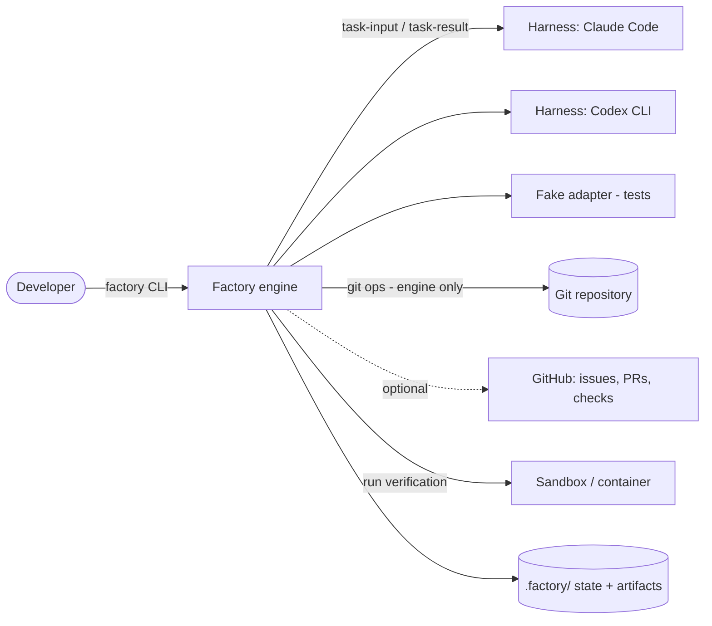
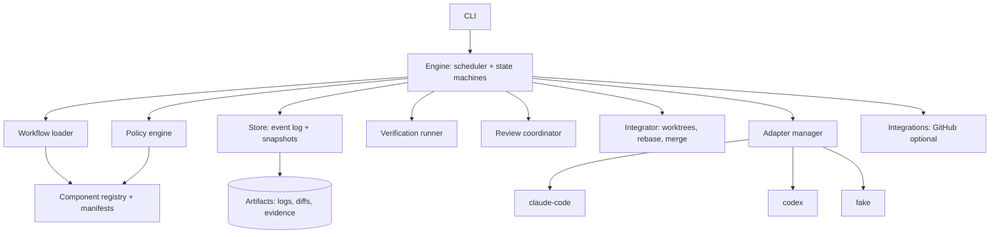
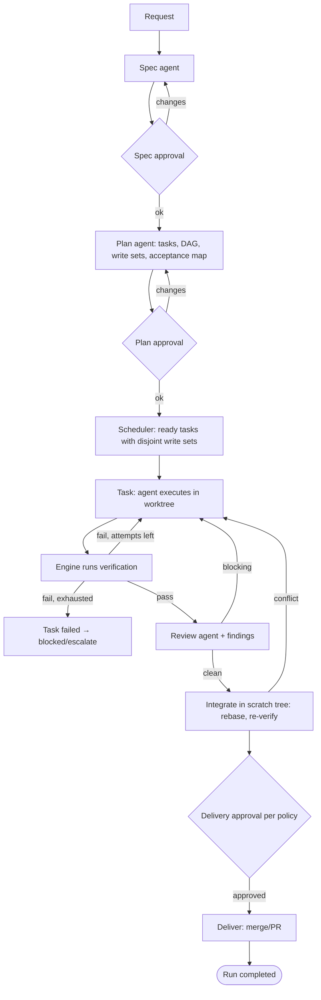
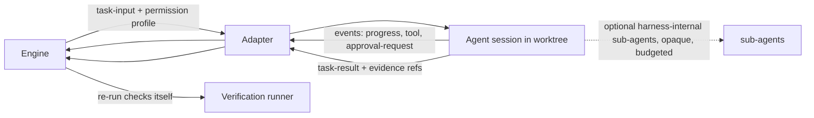
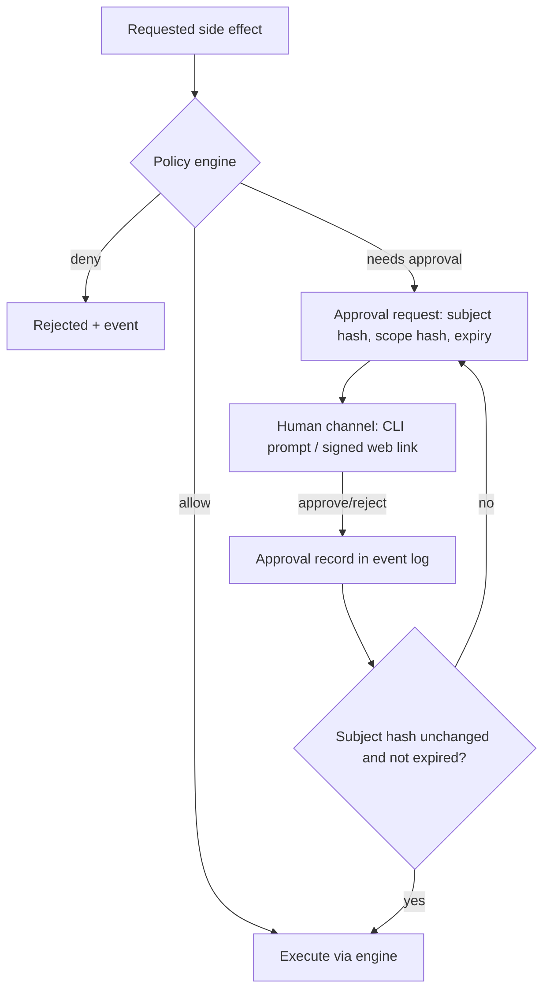
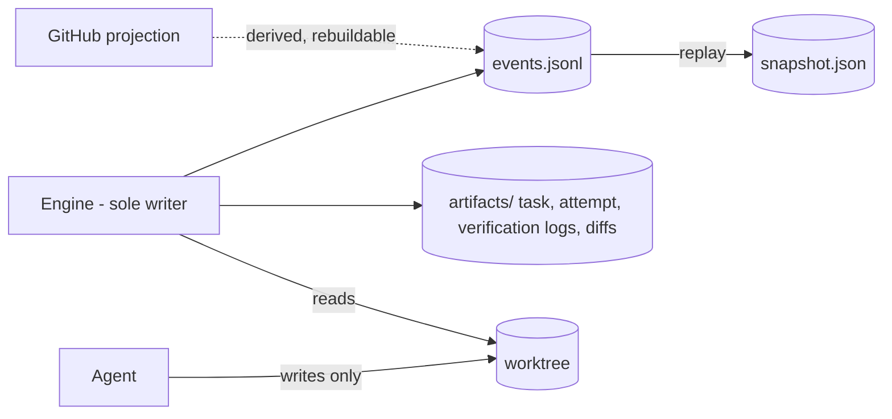
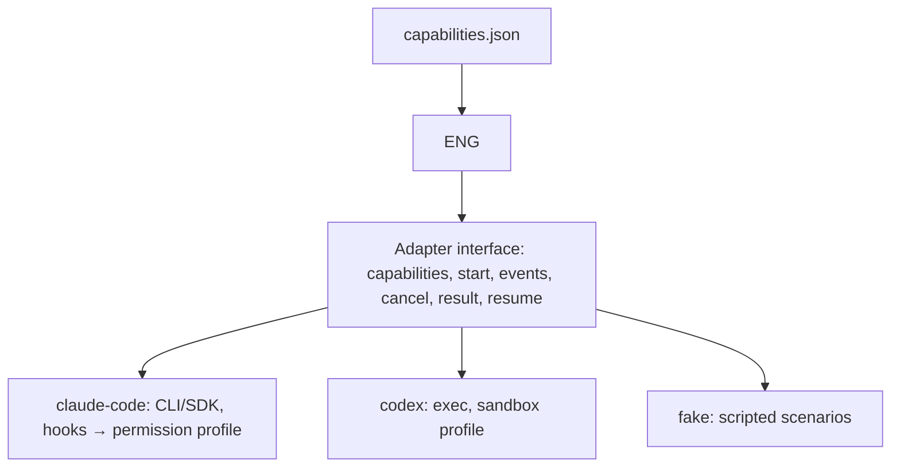
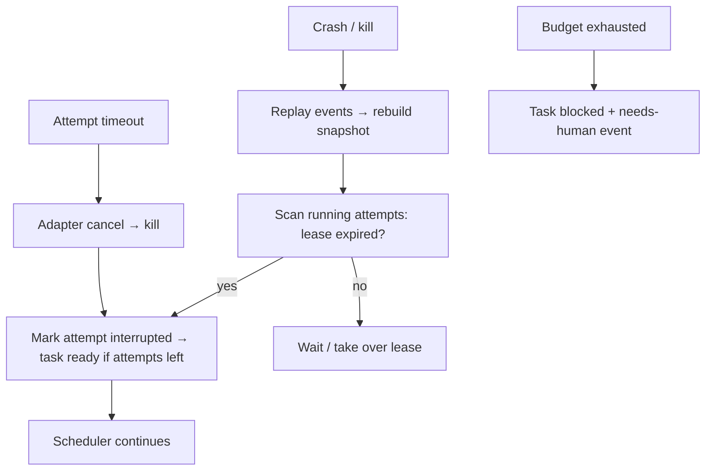

# 10 — New Factory Architecture (blueprint)

**Status: design proposal.** Facts about super-board are cited by finding ID (S-, R-, O-) from reports 08/09 and evidence files. Nothing below has been built or tested. Working name: **the factory** (CLI `factory`).

## 12.1 Product requirements

| Area | MVP (mandatory) | Later (P1+) |
|---|---|---|
| Purpose | Turn a written request into reviewed, verified, integrated changes in a git repository, with every step recorded and every risky action gated | multi-repo, deploy, scheduling |
| Users | Individual developers and small teams running locally or in a container | org-wide server |
| Workflows | One default lifecycle: spec → plan → execute (tasks) → verify → review → integrate → deliver | custom workflows, intake automation |
| Repositories | Local git repos with a runnable test/verify command; GitHub optional | GitLab, monorepo ownership maps |
| Harnesses | Fake adapter + 1 real adapter (Claude Code **or** Codex, whichever is first) → 2nd real adapter in P1 | generic CLI, others (unknown until probed) |
| Required components | engine, state store, policy engine, verification runner, workflow loader, adapter interface, CLI | |
| Optional | GitHub integration, QA/browser verifier, collect/intake, dashboards, notifications | |
| Non-goals (MVP) | UI, marketplace, distributed workers, deploy pipelines, self-modifying workflows, auto-merge to protected branches by default | |
| Security boundaries | Agents run with least privilege in a per-task worktree; engine alone merges/pushes/deletes outside worktree; verification runs in scrubbed env; secrets by reference | OS/container sandbox profiles |
| Autonomy/approval | Levels L0–L4 (below); default **L2** | org policy packs |
| Performance | Engine overhead negligible vs model time; 4 parallel tasks by default; resume after crash within seconds by log replay | |
| Reliability | At-least-once task execution, exactly-once state transitions (idempotent events); no lost approvals; bounded retries | |
| Acceptance | See 11 phase gates; MVP accepted when the demo repo scenario (feature + bug + conflicting pair) completes under the fake adapter in CI and once under a real adapter, with a killed-mid-run recovery | |

**Autonomy levels** (policy, not code paths):
| Level | Meaning | Human approves |
|---|---|---|
| L0 | Plan only | everything; nothing executes |
| L1 | Execute in sandbox worktree | each task result, delivery |
| **L2 (default)** | Execute + verify + review automatically | spec, plan, delivery |
| L3 | As L2, auto-deliver low-risk classes | spec; delivery only for risk classes (auth, money, schema, size over cap, dependencies, CI config) |
| L4 | Full autonomy within budgets | only policy-defined exceptions |
Risk classes generalize super-board's `merge_policy` categories (money/auth/schema/size) — KEEP (O-01).

## 12.2 Architecture and diagrams

### D1 System context

The engine is the only actor that mutates git outside task worktrees, merges, or records approvals. Harnesses are subprocess/SDK sessions that see only their task bundle (fixes S-01, S-02).

### D2 Component architecture

Core packages have no vendor imports; adapters and integrations depend inward only.

### D3 Complete workflow

### D4 Agent execution and delegation

Delegation rule: engine-visible delegation only through the plan (separate tasks). Harness-internal sub-agents are allowed but consume the parent task's budget and cannot widen permissions.

### D5 Approval and policy enforcement

Approvals are created only from the authenticated human channel — never from agent-writable text (S-02). Subject-hash pinning keeps super-board's head-pinned semantics (O-04).

### D6 State and artifact ownership

### D7 Harness adapter

### D8 Failure and recovery


## 12.3 Domain model (minimum)
Justification: seven persisted entities cover the lifecycle; request, dependency and component are folded in (fewer tables to migrate).
| Entity | Purpose | Key fields | Identity | Lifecycle | Owner | Relations | Validation |
|---|---|---|---|---|---|---|---|
| **Project** | repo + settings | root, base_branch, verify[], policy, adapters | slug | long-lived | user | has Runs | verify commands argv arrays, non-trivial (lint rejects `true`) |
| **Run** | one execution of a workflow | request text, workflow id/version, autonomy, budgets, status | `R-<ulid>` | created→terminal | engine | has Spec, Plan, Tasks | status per state machine |
| **Spec** | agreed requirements | version, markdown, acceptance[] (id, text), status | `S-<run>-<v>` | draft→approved/superseded | spec agent + human | belongs Run | every acceptance has stable id |
| **Plan** | task DAG | version, tasks[] ref, status | `P-<run>-<v>` | draft→approved/superseded | plan agent + human | has Tasks | acyclic; every acceptance mapped to ≥1 task; write sets declared |
| **Task** | unit of work | title, role, objective, acceptance_ids, depends_on[], write_set[], risk_class, status, attempts | `T-<n>` | state machine | engine | has Attempts, Findings | write sets disjoint among parallel-ready tasks |
| **Attempt** | one agent execution | adapter, model tier, worktree/commit, usage, result ref, verification refs | `A-<task>-<n>` | started→finished | engine | has Verification, Events | result validates schema |
| **Verification** | engine-run check outcome | commands, exit codes, log artifact, base/head hashes | `V-…` | immutable | engine | belongs Attempt | records environment fingerprint |
| **Finding** | review issue | severity, location, text, status | `F-…` | open→resolved/waived | reviewer/human | belongs Task | blocking severity needs resolution |
| **Approval** | human decision | subject (type, id, hash), scope hash, decision, approver identity, expiry | `AP-…` | pending→granted/denied/expired | human channel | belongs Run | approver authenticated; hash must match at use |
| **Event** | audit record | seq, ts, run, type, payload, actor | `(run, seq)` | immutable | engine | — | append-only, checksummed |
| *Artifact* (file refs, not an entity table) | logs, diffs, evidence | path + sha256 in event payload | path | immutable | engine | — | hash recorded |
Component/manifest metadata lives in the registry (12), not in run state.

## 12.4 State machines
**Task states:** `pending → ready → running → verifying → reviewing → integrating → succeeded`; side states `awaiting_approval`, `blocked`, `failed`, `canceled`.
| From | To | Trigger | Precondition | On failure / notes |
|---|---|---|---|---|
| pending | ready | deps succeeded | all `depends_on` succeeded; no write-set overlap with running tasks | — |
| ready | running | scheduler picks | budget available; adapter capability match | lease acquired (owner, expiry) |
| running | verifying | adapter `result` received | result schema-valid | invalid → retry (counts attempt) |
| running | ready | attempt timeout/crash | attempts < max | event `attempt.interrupted` |
| verifying | running | engine-run checks fail | attempts < max | failure log passed as context |
| verifying | failed | checks fail, attempts exhausted | — | escalate: run `blocked` |
| verifying | reviewing | all required checks pass **run by engine** | — | agent claims alone never suffice |
| reviewing | running | blocking findings | attempts < max | findings attached |
| reviewing | integrating | no blocking findings | — | |
| integrating | succeeded | rebased + re-verified on current base; approval satisfied if policy requires | scratch-tree checks green | conflict → running (rebase task); policy → awaiting_approval |
| any non-terminal | blocked | needs human / dependency failure / budget | — | requires explicit `factory resume` |
| any non-terminal | canceled | user cancel | — | adapter cancel, worktree kept |
Terminal: succeeded, failed, canceled. **A task is `succeeded` only if** engine-run verification passed on the integrated head, no open blocking finding, and required approval exists (spec rule).
Retries: max attempts per task (default 3), backoff none for logic failures, exponential for infra errors; identical failure signature twice ⇒ `blocked` (root-cause cap, implemented in code unlike super-board R-01).
**Run states:** `created → specifying → awaiting_spec_approval → planning → awaiting_plan_approval → executing → delivering → completed`; plus `paused`, `blocked`, `failed`, `canceled`. `executing → delivering` requires all tasks succeeded; `completed` requires delivery recorded. Cancel: stop scheduling, cancel running attempts, keep worktrees. Recovery after interruption: replay log; running attempts with expired lease → interrupted.

## 12.5 Execution contract
Universal (all adapters): `task-input` and `task-result` JSON (schemas in 12; samples in 07 Part C): task id, objective, scope/exclusions, acceptance, context bundle (files, skill text, prior findings), permission profile, budgets, output schema, artifact refs, resume token; result status ∈ succeeded/failed/blocked/needs_approval/canceled, changes (commit), evidence (command, exit, log), findings, questions, usage. Progress/error/approval-request events: `{type, ts, task, payload}` streamed or polled. Cancel/timeout: engine calls `cancel(handle)`, waits grace period, then force-kills the process group; late results are discarded. Harness-specific: how permissions map (tool allow-list vs sandbox profile), how skills are delivered, how structured output is enforced, how sessions resume. Engine never trusts adapter-reported evidence as proof of success.

## 12.6 Workflow composition
**Decision: declarative YAML for lifecycle + Markdown for role prompts/skills + typed code for primitives.** Rationale: super-board's biggest weakness was control flow in prose (R-01, R-08); its best parts were code (planner, gate). Workflow YAML may only use engine primitives — `stage`, `for_each_task`, `loop(max, until)`, `gate(policy)`, `parallel(disjoint)` — so branching/loops/gates are validated and testable without model calls.
```yaml
workflow: default/1
stages:
  - {id: spec,    role: spec-writer,  gate: spec_approval}
  - {id: plan,    role: planner,      gate: plan_approval}
  - id: execute
    for_each_task: {role: builder, parallel: disjoint_write_sets, max_attempts: 3}
    after: [{verify: project.verify}, {review: {role: reviewer, blocking: [high, medium]}}]
  - {id: integrate, engine: integrator, gate: delivery_policy}
```
Customization without touching the core: replace a role's prompt/skill, add a stage that uses an installed component, change gates and budgets in `.factory/project.yaml`, add risk classes. New control-flow primitives require a core release.

## 12.7 State persistence
**Decision (MVP): append-only JSONL event log + derived snapshot + artifact files, single writer, behind a `Store` interface.** Reasons: durability/recovery by replay, human-readable and diffable, no server, portable across harnesses/OS, matches single-process MVP. Corruption avoidance: (1) engine holds an exclusive lease file (`O_EXCL` create, PID + heartbeat, stale takeover after expiry — fixes S-12 style races); (2) each event line `{seq, ts, type, payload, crc32}` written then `fsync`; (3) snapshots written to temp file + `fsync` + atomic `rename`; (4) on startup, truncate a torn final line, verify seq continuity, rebuild snapshot from log if mismatch; (5) state transitions are idempotent (event carries target state + expected previous state); (6) artifacts addressed by sha256 recorded in events. Trigger to move to SQLite (WAL): multiple concurrent engine processes, or run logs exceeding a few hundred MB — the `Store` interface isolates that change.

## 12.8 Testing strategy (pyramid)
| Layer | What | External model calls |
|---|---|---|
| Unit | state-machine guards, scheduler, policy, planner DAG/overlap checks, store | none |
| Schema/contract | JSON Schemas for all contracts; manifest validation; adapter contract suite | none |
| Deterministic workflow | full lifecycle against **fake adapter** scripts (success, flaky, malformed, slow, crash, conflicting edits) | none |
| Simulated agents | fake adapter replays recorded `task-result` fixtures; property tests on transitions | none |
| Adapter tests | per real adapter: capabilities probe, permission mapping, cancel, structured output | small, nightly |
| Repo fixtures | tiny repos (py/js) with known bugs/features; golden diffs checked by tests not by text | fake mostly |
| Failure injection | kill engine at every event boundary; corrupt tail; GitHub 403/429; disk full; verification flake | none |
| Security | permission-profile escape attempts (path traversal, env leak, network), approval forgery (agent-written text must not approve), injection fixtures in issue text | none/fake |
| End-to-end | demo scenario under one real adapter (manual/nightly) | yes |
Rule from super-board worth keeping (O-05, O-06): every incident-derived rule ships with a regression test.
