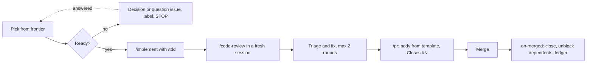

# Backlog: building agents-factory

This directory is the **source of truth for the build plan**: 39 ticket files in `tickets/`, the label set in `labels.json`, and the spec they hang from (`../spec/SPEC.md`). Issues on GitHub are created from these files by `tools/backlog/backlog.py create`, and every issue carries machine-readable dependency footers. Agents work one ticket at a time by following `../agents/ticket-runner.md`.

## The loop for each ticket



## Phases
| Phase | Theme | Tickets | Exit criterion |
|---|---|---|---|
| 0 | Shaping | DEC-01..07, SPK-01..03, MAP-01, SPEC-01 | Map cleared; SPEC-01 final and committed; spike evidence merged |
| 1 | Foundation and walking skeleton | T-01, T-02, T-03, RET-01 | `kill -9` at every event boundary recovers; retro done |
| 2 | Engine core | T-04..T-09 | Bounded execution, DAG, parallel scheduling, policy matrix and human-only approvals all proven at seams |
| 3 | Git integration and review | T-10, T-11 | Engine-only merge with re-verify; independent review with a convergence cap |
| 4 | Real harness | T-12, T-13 | Contract suite green on the fake and the first real adapter |
| 5 | Development lifecycle | T-14, T-15, T-16, RET-02 | **MVP acceptance**: spec → plan → execute → review → integrate → deliver at L2, plus kill-and-resume, plus one real run |
| 6 | Hardening | T-17, T-18, T-19, RET-03 | `docs/production-readiness.md` has no unexplained gaps |
| 7 | DX and extensibility (post-MVP) | T-20..T-24 | Optional; do T-22 only when a second component author exists |

**MVP = the `mvp`-labelled tickets** (T-01..T-16 and the decisions they need). Hardening (T-17..T-19) is the gate for calling it production-ready.

## Dependency graph (generated: `python tools/backlog/backlog.py graph`)

```mermaid
flowchart TD
  DEC_01["DEC-01<br/>Decide: implementation language and toolchain"]
  DEC_02["DEC-02<br/>Decide: first real harness adapter"]
  DEC_03["DEC-03<br/>Decide: default autonomy level and approval..."]
  DEC_04["DEC-04<br/>Decide: is GitHub integration part of the MVP?"]
  DEC_05["DEC-05<br/>Decide: names, license and distribution"]
  DEC_06["DEC-06<br/>Decide: verification isolation level"]
  DEC_07["DEC-07<br/>Decide: state store (JSONL log + snapshot v..."]
  SPK_01["SPK-01<br/>Spike: do the harness's permission controls..."]
  SPK_02["SPK-02<br/>Spike: structured output, cancel and resume..."]
  SPK_03["SPK-03<br/>Spike: GitHub merge and check semantics (on..."]
  MAP_01["MAP-01<br/>Map: settle MVP decisions before building"]
  SPEC_01["SPEC-01<br/>Spec: vendor-neutral Software Factory (MVP)"]
  T_01["T-01<br/>Bootstrap an agent-ready repository"]
  T_02["T-02<br/>Walking skeleton: one task end to end with ..."]
  T_03["T-03<br/>Crash-safe durable state and resume"]
  RET_01["RET-01<br/>Retro: after the walking skeleton and crash..."]
  T_04["T-04<br/>Bounded execution: retries, timeouts, budge..."]
  T_05["T-05<br/>Task dependencies and failure propagation"]
  T_06["T-06<br/>Validated config, verification lint, doctor..."]
  T_07["T-07<br/>Parallel execution with write-set disjointness"]
  T_08["T-08<br/>Policy engine: risk classes, autonomy level..."]
  T_09["T-09<br/>Hash-pinned approvals through a human-only ..."]
  T_10["T-10<br/>Git worktree isolation and the integrator (..."]
  T_11["T-11<br/>Independent review stage and the findings m..."]
  T_12["T-12<br/>Adapter contract suite, capability probing ..."]
  T_13["T-13<br/>First real harness adapter (per DEC-02) wit..."]
  T_14["T-14<br/>Spec stage with acceptance criteria and spe..."]
  T_15["T-15<br/>Plan stage: task DAG, write sets, acceptanc..."]
  T_16["T-16<br/>End-to-end lifecycle at L2 on fixture repos..."]
  RET_02["RET-02<br/>Retro: after the MVP lifecycle demo"]
  T_17["T-17<br/>Sandbox enforcement and the security test s..."]
  T_18["T-18<br/>Failure injection, soak runs and concurrent..."]
  T_19["T-19<br/>Observability: explain, events, export, usa..."]
  RET_03["RET-03<br/>Retro: after hardening (production-ready gate)"]
  T_20["T-20<br/>factory init: repo detection, templates and..."]
  T_21["T-21<br/>Managed install: lockfile, upgrade, uninsta..."]
  T_22["T-22<br/>Component manifests, registry and add/remov..."]
  T_23["T-23<br/>GitHub projection: PR delivery and status a..."]
  T_24["T-24<br/>Second adapter with a cross-adapter parity ..."]
  DEC_02 --> SPK_01
  DEC_02 --> SPK_02
  DEC_04 --> SPK_03
  DEC_01 --> MAP_01
  DEC_02 --> MAP_01
  DEC_03 --> MAP_01
  DEC_04 --> MAP_01
  DEC_05 --> MAP_01
  DEC_06 --> MAP_01
  DEC_07 --> MAP_01
  SPK_01 --> MAP_01
  SPK_02 --> MAP_01
  SPK_03 --> MAP_01
  MAP_01 --> SPEC_01
  DEC_01 --> T_01
  DEC_05 --> T_01
  T_01 --> T_02
  DEC_07 --> T_02
  T_02 --> T_03
  T_03 --> RET_01
  T_03 --> T_04
  T_03 --> T_05
  T_02 --> T_06
  DEC_06 --> T_06
  T_04 --> T_07
  T_05 --> T_07
  T_04 --> T_08
  T_06 --> T_08
  DEC_03 --> T_08
  T_08 --> T_09
  T_07 --> T_10
  T_09 --> T_10
  T_04 --> T_11
  T_06 --> T_11
  T_04 --> T_12
  T_12 --> T_13
  T_08 --> T_13
  SPK_01 --> T_13
  SPK_02 --> T_13
  DEC_02 --> T_13
  T_09 --> T_14
  T_12 --> T_14
  T_14 --> T_15
  T_07 --> T_15
  T_10 --> T_16
  T_11 --> T_16
  T_13 --> T_16
  T_15 --> T_16
  T_16 --> RET_02
  T_13 --> T_17
  DEC_06 --> T_17
  T_16 --> T_18
  T_16 --> T_19
  T_17 --> RET_03
  T_18 --> RET_03
  T_19 --> RET_03
  T_06 --> T_20
  T_16 --> T_20
  T_20 --> T_21
  T_21 --> T_22
  T_16 --> T_23
  DEC_04 --> T_23
  SPK_03 --> T_23
  T_13 --> T_24
  T_12 --> T_24
  style DEC_01 fill:#fff3cd,stroke:#b58900
  style DEC_02 fill:#fff3cd,stroke:#b58900
  style DEC_03 fill:#fff3cd,stroke:#b58900
  style DEC_04 fill:#fff3cd,stroke:#b58900
  style DEC_05 fill:#fff3cd,stroke:#b58900
  style DEC_06 fill:#fff3cd,stroke:#b58900
  style DEC_07 fill:#fff3cd,stroke:#b58900
  style MAP_01 fill:#ece4f7,stroke:#5319e7
  style RET_01 fill:#ece4f7,stroke:#5319e7
  style RET_02 fill:#ece4f7,stroke:#5319e7
  style RET_03 fill:#ece4f7,stroke:#5319e7
  style SPEC_01 fill:#ece4f7,stroke:#5319e7
  style SPK_01 fill:#e1ecf7,stroke:#1d76db
  style SPK_02 fill:#e1ecf7,stroke:#1d76db
  style SPK_03 fill:#e1ecf7,stroke:#1d76db
  style T_01 fill:#e6f0f0,stroke:#5f8a8b
  style T_02 fill:#e6f4ea,stroke:#0e8a16
  style T_03 fill:#e6f4ea,stroke:#0e8a16
  style T_04 fill:#e6f4ea,stroke:#0e8a16
  style T_05 fill:#e6f4ea,stroke:#0e8a16
  style T_06 fill:#e6f4ea,stroke:#0e8a16
  style T_07 fill:#e6f4ea,stroke:#0e8a16
  style T_08 fill:#e6f4ea,stroke:#0e8a16
  style T_09 fill:#e6f4ea,stroke:#0e8a16
  style T_10 fill:#e6f4ea,stroke:#0e8a16
  style T_11 fill:#e6f4ea,stroke:#0e8a16
  style T_12 fill:#e6f4ea,stroke:#0e8a16
  style T_13 fill:#e6f4ea,stroke:#0e8a16
  style T_14 fill:#e6f4ea,stroke:#0e8a16
  style T_15 fill:#e6f4ea,stroke:#0e8a16
  style T_16 fill:#e6f4ea,stroke:#0e8a16
  style T_17 fill:#e6f4ea,stroke:#0e8a16
  style T_18 fill:#e6f4ea,stroke:#0e8a16
  style T_19 fill:#e6f4ea,stroke:#0e8a16
  style T_20 fill:#e6f4ea,stroke:#0e8a16
  style T_21 fill:#e6f4ea,stroke:#0e8a16
  style T_22 fill:#e6f4ea,stroke:#0e8a16
  style T_23 fill:#e6f4ea,stroke:#0e8a16
  style T_24 fill:#e6f4ea,stroke:#0e8a16
```


**MVP critical path (10 deep):** DEC-05 → T-01 → T-02 → T-03 → T-04 → T-08 → T-09 → T-14 → T-15 → T-16

### Parallel lanes (generated)
Tickets on the same level have no dependency on each other and can run in parallel in separate worktrees (`../agents/parallel-work.md`).

| Level | Tickets |
|---|---|
| 0 | DEC-01 DEC-02 DEC-03 DEC-04 DEC-05 DEC-06 DEC-07 |
| 1 | SPK-01 SPK-02 SPK-03 T-01 |
| 2 | MAP-01 T-02 |
| 3 | SPEC-01 T-03 T-06 |
| 4 | RET-01 T-04 T-05 |
| 5 | T-07 T-08 T-11 T-12 |
| 6 | T-09 T-13 |
| 7 | T-10 T-14 T-17 T-24 |
| 8 | T-15 |
| 9 | T-16 |
| 10 | RET-02 T-18 T-19 T-20 T-23 |
| 11 | RET-03 T-21 |
| 12 | T-22 |

## Every ticket and its relationships (generated: `python tools/backlog/backlog.py table`)
| ID | Type | Phase | Mode | Size | Title | Blocked by | Blocks | Skills |
|---|---|---|---|---|---|---|---|---|
| DEC-01 | decision | 0 | HITL | - | Decide: implementation language and toolchain | - | MAP-01, T-01 | grill-with-docs, domain-modeling |
| DEC-02 | decision | 0 | HITL | - | Decide: first real harness adapter | - | MAP-01, SPK-01, SPK-02, T-13 | grill-with-docs |
| DEC-03 | decision | 0 | HITL | - | Decide: default autonomy level and approval channel | - | MAP-01, T-08 | grill-with-docs, domain-modeling |
| DEC-04 | decision | 0 | HITL | - | Decide: is GitHub integration part of the MVP? | - | MAP-01, SPK-03, T-23 | grill-with-docs |
| DEC-05 | decision | 0 | HITL | - | Decide: names, license and distribution | - | MAP-01, T-01 | grill-with-docs, domain-modeling |
| DEC-06 | decision | 0 | HITL | - | Decide: verification isolation level | - | MAP-01, T-06, T-17 | grill-with-docs |
| DEC-07 | decision | 0 | HITL | - | Decide: state store (JSONL log + snapshot vs SQLite) | - | MAP-01, T-02 | grill-with-docs, domain-modeling |
| SPK-01 | spike | 0 | AFK | - | Spike: do the harness's permission controls hold in headless and sub-agent runs? | DEC-02 | MAP-01, T-13 | research |
| SPK-02 | spike | 0 | AFK | - | Spike: structured output, cancel and resume for the chosen harness | DEC-02 | MAP-01, T-13 | research |
| SPK-03 | spike | 0 | AFK | - | Spike: GitHub merge and check semantics (only if DEC-04 says yes) | DEC-04 | MAP-01, T-23 | research |
| MAP-01 | map | 0 | HITL | - | Map: settle MVP decisions before building | DEC-01, DEC-02, DEC-03, DEC-04, DEC-05, DEC-06, DEC-07, SPK-01, SPK-02, SPK-03 | SPEC-01 | wayfinder, grilling, domain-modeling, to-spec |
| SPEC-01 | spec | 0 | HITL | - | Spec: vendor-neutral Software Factory (MVP) | MAP-01 | - | to-spec, domain-modeling |
| T-01 | chore | 1 | HITL | M | Bootstrap an agent-ready repository | DEC-01, DEC-05 | T-02 | setup-matt-pocock-skills, domain-modeling |
| T-02 | build | 1 | AFK | M | Walking skeleton: one task end to end with the fake adapter | T-01, DEC-07 | T-03, T-06 | implement, tdd, code-review, pr |
| T-03 | build | 1 | AFK | M | Crash-safe durable state and resume | T-02 | RET-01, T-04, T-05 | implement, tdd, code-review, pr |
| RET-01 | retro | 1 | HITL | - | Retro: after the walking skeleton and crash-safe state | T-03 | - | retro, handoff |
| T-04 | build | 2 | AFK | M | Bounded execution: retries, timeouts, budgets, cancel, no-progress | T-03 | T-07, T-08, T-11, T-12 | implement, tdd, code-review, pr |
| T-05 | build | 2 | AFK | M | Task dependencies and failure propagation | T-03 | T-07 | implement, tdd, code-review, pr |
| T-06 | build | 2 | AFK | M | Validated config, verification lint, doctor, scrubbed-environment runner | T-02, DEC-06 | T-08, T-11, T-20 | implement, tdd, code-review, pr |
| T-07 | build | 2 | AFK | M | Parallel execution with write-set disjointness | T-04, T-05 | T-10, T-15 | implement, tdd, code-review, pr |
| T-08 | build | 2 | AFK | M | Policy engine: risk classes, autonomy levels, permission profiles | T-04, T-06, DEC-03 | T-09, T-13 | implement, tdd, code-review, pr |
| T-09 | build | 2 | AFK | M | Hash-pinned approvals through a human-only channel | T-08 | T-10, T-14 | implement, tdd, code-review, pr |
| T-10 | build | 3 | AFK | M | Git worktree isolation and the integrator (engine-only merge) | T-07, T-09 | T-16 | implement, tdd, code-review, pr |
| T-11 | build | 3 | AFK | M | Independent review stage and the findings model | T-04, T-06 | T-16 | implement, tdd, code-review, pr |
| T-12 | build | 4 | AFK | M | Adapter contract suite, capability probing and graceful degradation | T-04 | T-13, T-14, T-24 | implement, tdd, code-review, pr |
| T-13 | build | 4 | HITL | M | First real harness adapter (per DEC-02) with permission mapping | T-12, T-08, SPK-01, SPK-02, DEC-02 | T-16, T-17, T-24 | implement, tdd, code-review, pr |
| T-14 | build | 5 | AFK | M | Spec stage with acceptance criteria and spec approval | T-09, T-12 | T-15 | implement, tdd, code-review, pr |
| T-15 | build | 5 | AFK | M | Plan stage: task DAG, write sets, acceptance coverage, plan approval | T-14, T-07 | T-16 | implement, tdd, code-review, pr |
| T-16 | build | 5 | AFK | M | End-to-end lifecycle at L2 on fixture repos (MVP acceptance) | T-10, T-11, T-13, T-15 | RET-02, T-18, T-19, T-20, T-23 | implement, tdd, code-review, pr |
| RET-02 | retro | 5 | HITL | - | Retro: after the MVP lifecycle demo | T-16 | - | retro, handoff |
| T-17 | build | 6 | AFK | M | Sandbox enforcement and the security test suite | T-13, DEC-06 | RET-03 | implement, tdd, code-review, pr |
| T-18 | build | 6 | AFK | M | Failure injection, soak runs and concurrent runs per repository | T-16 | RET-03 | implement, tdd, code-review, pr |
| T-19 | build | 6 | AFK | M | Observability: explain, events, export, usage and replay | T-16 | RET-03 | implement, tdd, code-review, pr |
| RET-03 | retro | 6 | HITL | - | Retro: after hardening (production-ready gate) | T-17, T-18, T-19 | - | retro, handoff |
| T-20 | build | 7 | AFK | M | factory init: repo detection, templates and generated reference docs | T-06, T-16 | T-21 | implement, tdd, code-review, pr |
| T-21 | build | 7 | AFK | M | Managed install: lockfile, upgrade, uninstall, rollback, signed releases | T-20 | T-22 | implement, tdd, code-review, pr |
| T-22 | build | 7 | AFK | M | Component manifests, registry and add/remove/replace commands | T-21 | - | implement, tdd, code-review, pr |
| T-23 | build | 7 | AFK | M | GitHub projection: PR delivery and status as an optional integration | T-16, DEC-04, SPK-03 | - | implement, tdd, code-review, pr |
| T-24 | build | 7 | AFK | M | Second adapter with a cross-adapter parity suite | T-13, T-12 | - | implement, tdd, code-review, pr |

## Which skill does what
| Activity | Skill | Used for here |
|---|---|---|
| One-time repo setup | `/setup-matt-pocock-skills` | writes `docs/agents/*` and the `## Agent skills` block (pre-filled in this bundle; run once to confirm) |
| Settle decisions | `/wayfinder` (map), `/grill-with-docs`, `/grilling`, `/domain-modeling` | DEC-01..07 and MAP-01; glossary and ADR updates |
| Gather evidence | `/research`, `/prototype` | SPK-01..03 |
| Turn open questions into a fill-in doc | `/to-questionnaire` | the questions under each decision, for the maintainer |
| Collapse decisions into a spec | `/to-spec` | SPEC-01 (`/to-spec #<map issue>` when the map clears) |
| Split a spec into tickets | `/to-tickets` | already done in this backlog; use for later change requests or new slices |
| Build a ticket | `/implement` (uses `/tdd`; `/codebase-design` for module shape) | every `type:build` ticket |
| Review | `/code-review` | fresh session per ticket; protocol in `../agents/review-protocol.md` |
| PR body | `/pr` | inside the repo template; checked by CI |
| Triage human-filed issues | `/triage` | anything labelled `needs-triage` |
| Long sessions | `/handoff` | context exhausted mid-ticket |
| Phase retros | `/retro` | RET-01..03 |
| Fan out a whole spec | `/implement-spec` (optional) | only with worktrees; same protocol per worker |
| Not sure which skill | `/ask-matt` | any time |

## Rules of the road
`../agents/ticket-runner.md` (the protocol), `../agents/decisions-and-questions.md` (how to escalate), `../agents/review-protocol.md`, `../agents/pr-protocol.md`, `../agents/parallel-work.md`, `../agents/issue-tracker.md`, `../agents/triage-labels.md`, `../../CODING_STANDARDS.md`, `../../GLOSSARY.md`.

## Maintainer snippets
Create labels (once): `bash tools/backlog/create-labels.sh`.
See what an agent may pick: `python tools/backlog/backlog.py next`.
Create all issues (dry run first): `python tools/backlog/backlog.py create` then `... create --apply`.

**Accept recommended defaults for every decision except DEC-05** (untested here; review before running, and answer any question whose answer differs from the recommendation first):
```
for n in $(gh issue list --label type:decision --state open --json number,title \
           --jq '.[] | select(.title | test("DEC-05") | not) | .number'); do
  gh issue comment $n --body "**Resolved:** accepted the recommendation as written. Decided by: <your name>, $(date +%F)."
  gh issue close $n
done
```
Then edit `docs/spec/SPEC.md` so every `**[proposed]**` marker is removed or amended and close MAP-01. **Keep SPEC-01 open** until the whole project is done: it is the parent issue and the `on-merged` ledger comments are written to the open spec issue.

## Regenerating
The graph, lanes and table above are generated; after changing a ticket's `blocked_by` or labels, re-run `backlog.py graph` and `backlog.py table` and update this file. `backlog.py validate` runs in CI.
